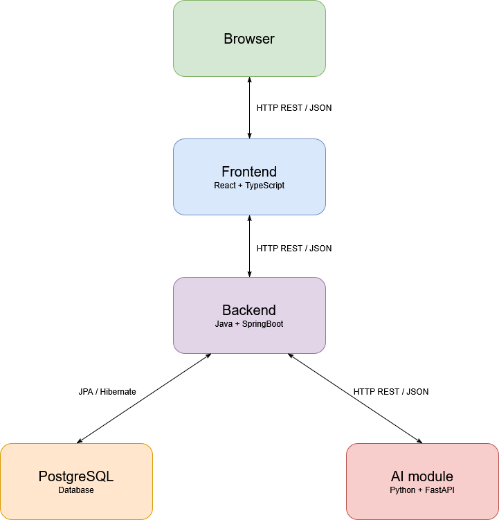
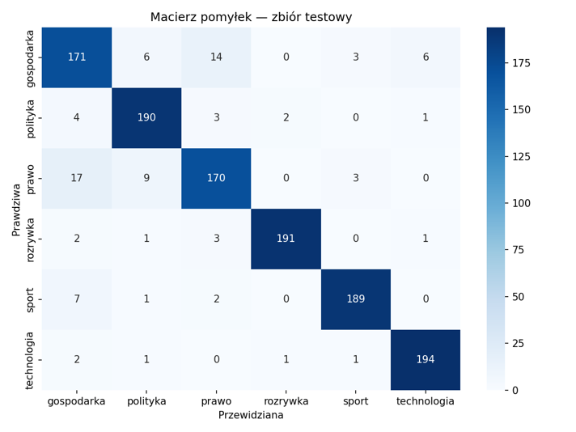
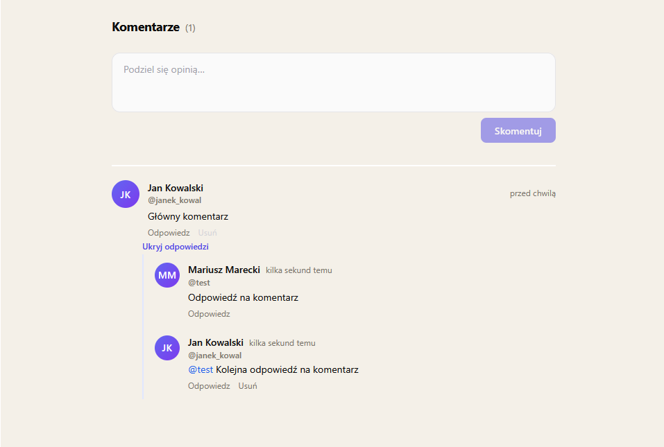
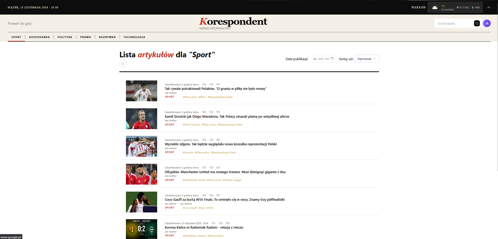
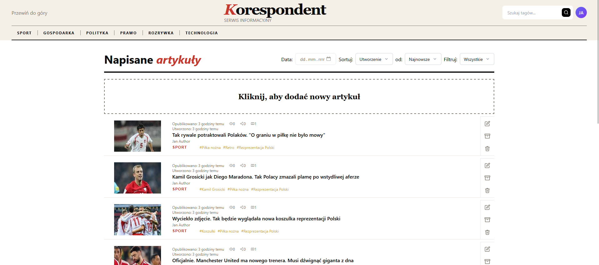
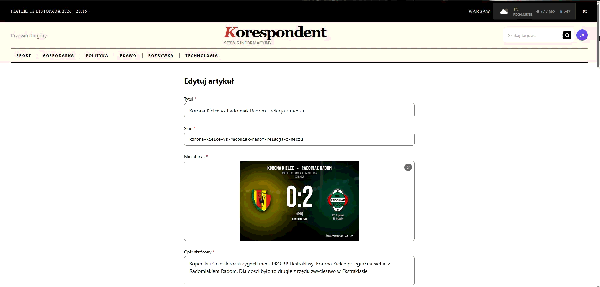
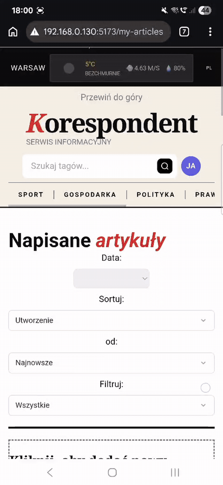
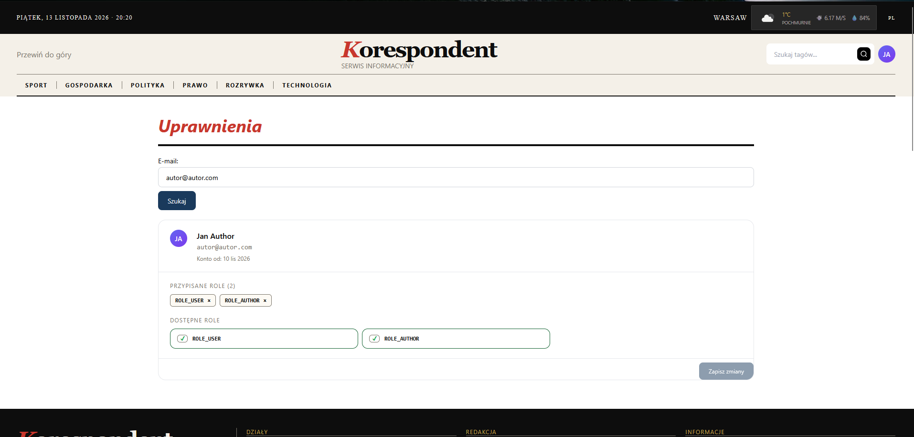
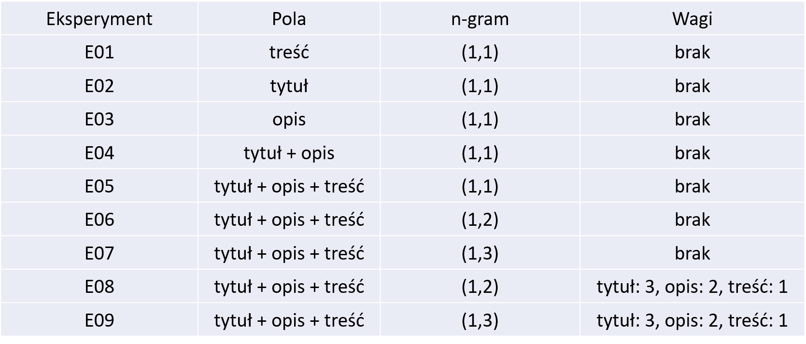
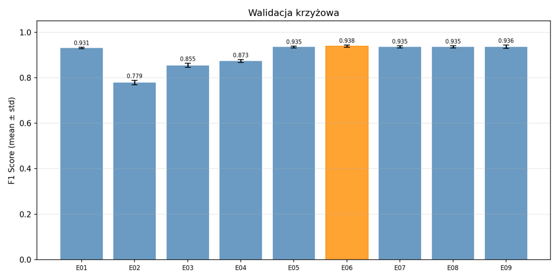

# korespondent-news-platform

AI-Assisted News Management Platform

**Language:** This README is written in English. A Polish version is also available in [README.pl.md](README.pl.md).

# Korespondent – AI-Assisted News Management Platform

**Korespondent** is a web application for creating, managing, and presenting news content. It combines the features of a publishing platform with an AI module that supports automatic article classification.

Users can browse published content, while authors can create their own articles and enrich them with external materials, such as embedded YouTube videos and images from other sources.

The application also includes user and permission management, content personalisation, and an NLP module that uses a dedicated PyTorch model to automatically assign articles to one of six categories.

## 2. Main Features

### Content Management

- Creating and editing articles using the Editor.js block editor.
- Embedding external content, such as YouTube videos and media from other sources.
- Browsing published articles.
- Managing content according to the user's assigned permissions.

### Article Search and Filtering

- Filtering articles by category, tags, author, and other criteria.
- Sorting articles by publication date and other criteria.

### Content Personalisation

- Choosing favourite categories.
- Following selected tags and authors.
- Creating and managing reading lists.

### Automatic Article Classification

- Using a PyTorch model to automatically assign articles to one of six categories.
- Classifying articles based on their title, lead, and body.
- Connecting the NLP module to the application backend through an API.

### User Management and Moderation

- Supporting different user roles.
- Granting and removing permissions.
- Content moderation by the administrator.

### Adding Comments

- Adding and managing comments under articles.
- Replying to comments posted by other users.

## 3. User Roles and Permissions

The system uses a permission model based on four user roles. Each role provides access to a specific set of features.

### Guest

- Browsing available articles.
- Filtering and sorting content.
- Searching for tags.

### Registered User

- All features available to guests.
- Managing favourite categories.
- Following selected tags and authors.
- Creating and managing reading lists.

### Author

- Creating articles.
- Editing articles written by the author.
- Managing created content and its status.

### Admin

- Managing users and their permissions.
- Assigning and removing roles.
- Moderating all articles in the system.
- Managing content regardless of its author.

### Permission Model

| Feature | Guest | Registered User | Author | Admin |
|---|:---:|:---:|:---:|:---:|
| Browsing articles | + | + | + | + |
| Filtering and searching | + | + | + | + |
| Content personalisation | - | + | + | + |
| Adding comments | - | + | + | + |
| Managing reading lists | - | + | + | + |
| Creating articles | - | - | + | + |
| Editing own articles | - | - | + | + |
| Editing articles written by other authors | - | - | - | + |
| Managing users and roles | - | - | - | + |
| Content moderation | - | - | - | + |

## 4. Technologies and Libraries

The Korespondent project uses technologies selected for the different layers of the system. Its architecture consists of a frontend, a backend, and a separate AI/NLP module that communicates with the backend through an API.

### Frontend

The frontend was built using React and TypeScript.

- **React 19** – building the user interface with reusable components.
- **TypeScript** – static typing that improves code readability and safety.
- **Vite** – development environment and application build tool.
- **Tailwind CSS** – styling interface components.
- **React Router** – handling application navigation and routing.
- **TanStack React Query** – managing API communication, including data fetching, caching, mutations, and synchronisation.
- **Axios** – handling HTTP requests sent to the backend.
- **Zustand** – managing shared interface state, including article filtering and sorting settings.
- **React Hook Form + Zod** – handling forms and validating user input.
- **Editor.js** – a block-based editor used to create and edit news articles.

### Backend

The backend is based on Java and the Spring Boot framework.

- **Java 25** – the main programming language used for the backend.
- **Spring Boot 4** – implementing business logic and providing the REST API.
- **Maven** – managing dependencies and the project build process.
- **PostgreSQL** – a relational database that stores information about users, articles, categories, tags, and preferences.
- **JPA / Hibernate** – object-relational mapping and database operations.
- **Spring Security** – securing the application and controlling access to resources.
- **JWT (JSON Web Token)** – an authentication mechanism that also carries information about user permissions.
- **MapStruct** – mapping objects between application layers.
- **Lombok** – reducing repetitive Java code.

### AI / NLP Module

The AI module was developed in Python as a separate service. It is responsible for data preparation, model training and evaluation, and providing article classification features.

- **Python** – the programming language used to develop the AI module.
- **PyTorch** – implementing and training a Multilayer Perceptron (MLP) neural network used for article classification.
- **FastAPI** – making the model available through an API so that the application backend can communicate with it.
- **Pandas** – processing and analysing datasets.
- **NumPy** – numerical operations and data preparation.
- **Scikit-learn** – data preparation, model validation, and calculation of classification performance metrics.
- **Matplotlib / Seaborn** – visualising data and experiment results.
- **Pydantic** – validating API input and output data.

## 5. System Architecture

Korespondent uses an architecture that separates the frontend, backend, database, and independent AI module. The components communicate through REST APIs and use JSON as the data format.

### Main System Components

The system consists of four main components:

- **Frontend (React + TypeScript)** – provides the user interface, displays content, handles forms, and communicates with the backend through the REST API. Axios is used to handle HTTP requests.
- **Backend (Java + Spring Boot)** – acts as the central layer of the system. It handles business logic, user authentication and authorisation, article management, and communication with the database and AI module.
- **Database (PostgreSQL)** – stores application data, including information about users, roles, articles, categories, tags, and preferences.
- **AI/NLP Module (Python + FastAPI + PyTorch)** – runs as a separate service responsible for article classification. It provides the MLP model through a REST API. The trained model is stored in a local file and loaded by the service when it starts.

### Communication Between Components

The frontend and backend communicate over HTTP using a REST API and JSON.

The backend also communicates with the separate AI module, which provides its own API built with FastAPI. Database operations are handled using JPA/Hibernate.

### Article Classification Flow

Article classification is started by the author. The process works as follows:

1. The user starts article classification in the application.
2. The frontend sends a request to the backend.
3. The backend sends the article data to the AI module.
4. The AI module processes the text using the trained MLP model and returns the classification result.
5. The backend sends the suggested category to the frontend.
6. The author or administrator can review and approve the suggested category.

Classification supports the content management process. The final decision about the article's category remains with the user who has permission to manage that article.

## 6. AI Module – Article Classification

One of the main parts of the system is an NLP module that can automatically classify news articles. It uses a Multilayer Perceptron (MLP) neural network implemented in PyTorch.

### Classification Goal and Scope

The model was designed to automatically assign articles to one of six topic categories:

- Sports
- Economy
- Politics
- Law
- Entertainment
- Technology

The classification process uses information from the article title, lead, and main body.

### Data Preparation

The model was trained on a custom dataset prepared from articles published on WikiNews.

Before training, the data went through several processing steps:

1. **Data validation** – identifying and removing invalid records, such as empty texts, texts containing only numbers, texts containing HTML code, or texts that did not meet the required length criteria.
2. **Text normalisation** – making the text format consistent and preparing it for further processing.
3. **Text length limit** – setting the maximum input length to 645 tokens based on a statistical analysis of the dataset.
4. **Tokenisation and lemmatisation** – splitting the text into tokens and reducing words to their base forms.
5. **Stop-word filtering** – removing words with little information value for the classification process.
6. **TF-IDF vectorisation** – converting text into numerical vectors that reflect the importance of individual terms.
7. **Label encoding** – converting topic categories into numerical values used during model training.

### Model Architecture and How It Works

The classification process uses a Multilayer Perceptron (MLP) neural network implemented with PyTorch. The model takes TF-IDF vectors representing the articles as input. It then processes them through the network layers. The output layer uses the Softmax function to produce a probability distribution across the six topic categories. The category with the highest probability is selected as the result.

### Integration with the Application

The trained model was saved in a local file and made available through a separate service built with FastAPI. The author starts the classification process when needed. The backend sends the article data to the AI module and then receives the classification result. The returned category is a suggestion that the user can accept or reject. The model does not assign categories automatically; the final decision remains with the author.

### Evaluation of the Selected Model

Classification quality was evaluated using four main metrics:

- **Accuracy** – the overall percentage of correct classifications.
- **Precision** – how accurately the model assigns articles to individual categories.
- **Recall** – how well the model identifies articles that belong to each category.
- **F1-score** – a metric that combines Precision and Recall.

Scikit-learn was used for data preparation and metric calculation. The experiment results are presented below in a table and as a visualisation.

| Accuracy | Precision | Recall | F1-score |
|:---:|:---:|:---:|:---:|
| 0.94686 | 0.925077 | 0.924768 | 0.924768 |

## 7. User Interface

The Korespondent user interface was built with React and Tailwind CSS. It was designed to be responsive and to provide features based on the permissions assigned to each user.

The application supports both large desktop screens and smaller mobile devices. The layout and interface elements adjust to the available screen space.

### Main Application Views

The interface includes several main areas:

- **Home page** – browsing articles, filtering them by category and tags, and sorting content.
- **Article view** – displaying the full article, including author information, tags, and external media.
- **User panel** – managing preferences, followed categories, tags and authors, as well as reading lists.
- **Author panel** – creating and editing articles, managing their status, and using the AI classification feature.
- **Admin panel** – managing users, assigning and removing roles, and moderating content.

### User Interface and Roles

The system allows one user to have multiple roles at the same time. The roles are not mutually exclusive, so, for example, an administrator can also act as an author.

Each role provides access to specific panels and features. Access depends on the permissions assigned to the user's account.

### Responsiveness

The interface was adapted to two main types of devices:

- **Desktop** – makes use of the larger screen space, allowing users to browse content and work with management panels comfortably.
- **Mobile devices** – the layout, navigation, and content are adjusted to fit smaller screens.

### Application Screens

**Home Page**
 

 

**Article**
 

 

**Comments Section**
 

**Article List with Sorting and Filtering**
 

**List of Articles Written by the Author**
 

**Article Editor** 
 

 

**Admin Panel**
 

## 8. Testing and Results

### Application Testing

The Korespondent system was tested using unit tests, integration tests, and manual tests of selected features.

- **Unit tests** – checking whether selected parts of the application logic work correctly.
- **Integration tests** – checking whether selected system components work correctly together.
- **API tests** – using Postman to check backend endpoints, request handling, and authentication and authorisation mechanisms.
- **Permission checks** – verifying access to specific features and API resources based on the user's role.

Unit and integration tests were implemented for selected parts of the application. All tests that were run passed successfully.

### AI Model Experiments and Evaluation

Experiments were carried out as part of the classification module development to check how different text representations affect article classification quality.

The tested options included:

- **Different input data representations** – using the title, lead, and main article body separately and in different combinations.
- **Different weights for article sections** – checking how assigning different weights to the title, lead, and main body affects classification results.
- **Different n-gram settings** – checking how TF-IDF vectorisation settings affect text representation and classification performance.

The results of the experiments are shown below:
 

 

