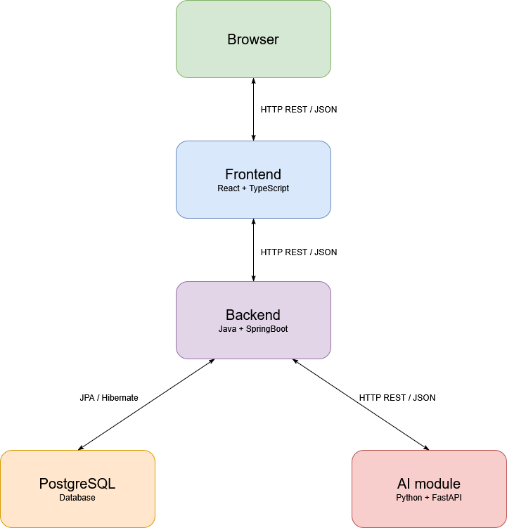
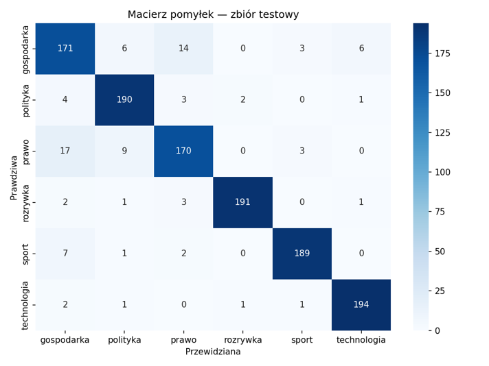
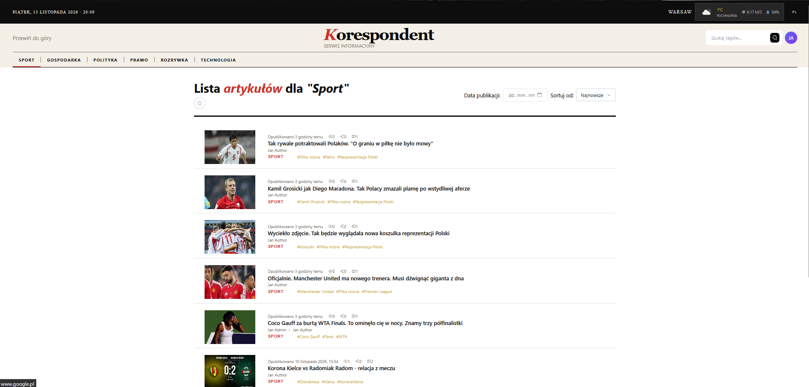
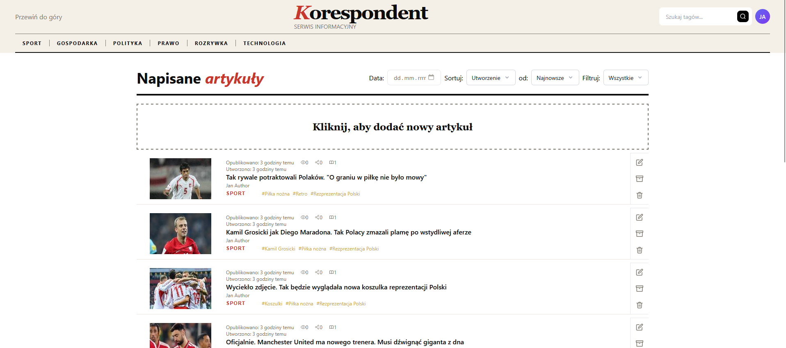
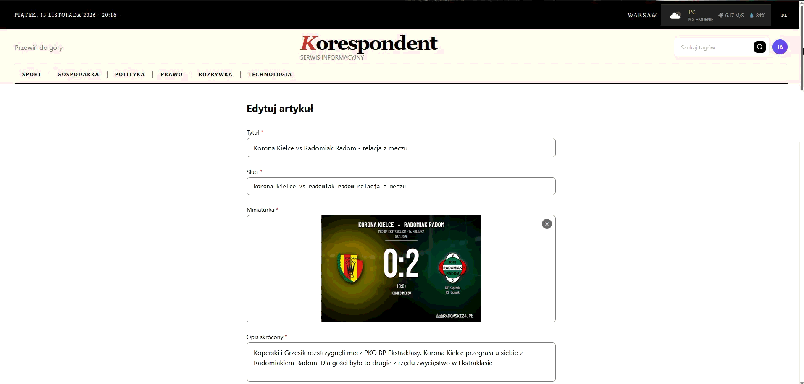
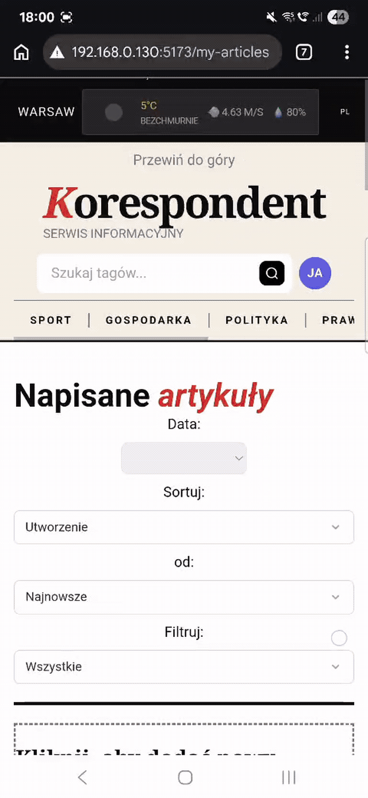
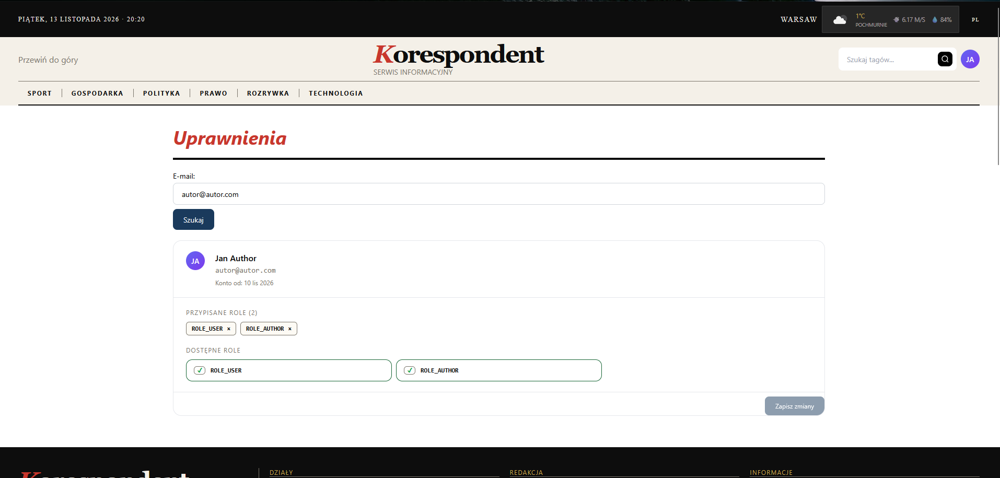
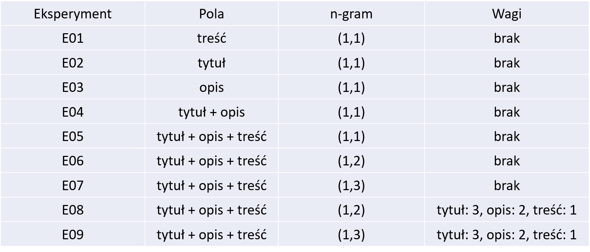
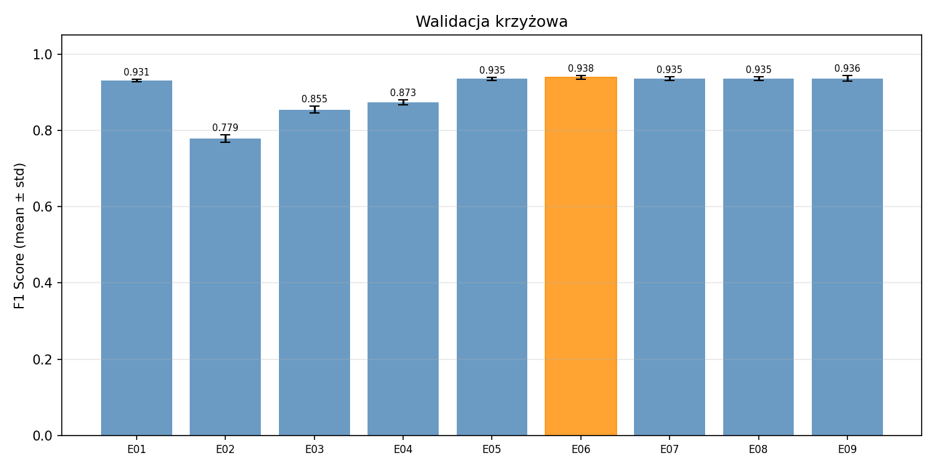

# korespondent-news-platform
AI-Assisted News Management Platform

# Korespondent - platforma do zarządzania treściami informacyjnymi wspierana przez AI

**Korespondent** to aplikacja webowa umożliwiająca tworzenie, zarządzanie i prezentowanie treści informacyjnych. System łączy funkcjonalności platformy publikacyjnej z modułem sztucznej inteligencji wspierającym automatyczną klasyfikację artykułów.

Użytkownicy mogą przeglądać publikowane treści, natomiast autorzy mają możliwość tworzenia własnych artykułów oraz wzbogacania ich o materiały zewnętrzne, takie jak osadzone materiały wideo z YouTube czy obrazy pochodzące z innych źródeł.

Aplikacja oferuje również system zarządzania użytkownikami i uprawnieniami, personalizację przeglądanych treści oraz moduł NLP wykorzystujący dedykowany model PyTorch do automatycznego przypisywania artykułów do jednej z sześciu kategorii.

## 2. Główne funkcjonalności systemu

### Zarządzanie treściami
- Tworzenie i edycja własnych artykułów z wykorzystaniem edytora blokowego Editor.js.
- Osadzanie materiałów zewnętrznych, takich jak np.: filmy z YouTube i multimedia z innych źródeł.
- Przeglądanie opublikowanych artykułów.
- Zarządzanie treściami zgodnie z przypisanymi uprawnieniami użytkownika.

### Wyszukiwanie i filtrowanie artykułów

- Filtrowanie artykułów według kategorii, tagów, autora itp.
- Sortowanie artykułów według czasu publikacji itp.

### Personalizacja treści
- Wybór ulubionych kategorii.
- Zarządzanie obserwowanymi tagami i autorami.
- Tworzenie i zarządzanie listami artykułów do przeczytania.

### Automatyczna klasyfikacja artykułów
- Wykorzystanie modelu PyTorch do automatycznego przypisywania artykułów do jednej z sześciu kategorii.
- Klasyfikacja na podstawie tytułu, leadu i treści artykułu.
- Integracja modułu NLP z backendem aplikacji za pośrednictwem API.

### Zarządzanie użytkownikami i moderacja
- Obsługa różnych ról użytkowników.
- Nadawanie i odbieranie uprawnień.
- Moderowanie treści przez administratora.

### Dodawanie komentarzy
- Tworzenie i zarządzanie własnymi komentarzami pod artykułami.
- Odpowiadanie na komentarze innych użytkowników. 

## 3. Role i uprawnienia użytkowników

System wykorzystuje model uprawnień oparty na czterech rolach użytkowników. Każda rola zapewnia dostęp do określonego zakresu funkcjonalności.

### Gość
- Przeglądanie dostępnych artykułów.
- Filtrowanie i sortowanie treści.
- Wyszukiwanie tagów.

### Zarejestrowany użytkownik
- Wszystkie funkcjonalności dostępne dla gościa.
- Zarządzanie ulubionymi kategoriami.
- Obserwowanie wybranych tagów i autorów.
- Tworzenie i zarządzanie listami artykułów do przeczytania.

### Autor
- Tworzenie własnych artykułów.
- Edycja artykułów, których jest autorem.
- Zarządzanie tworzonymi treściami i ich statusami.

### Admin
- Zarządzanie użytkownikami i ich uprawnieniami.
- Nadawanie i odbieranie ról.
- Moderowanie wszystkich artykułów w systemie.
- Zarządzanie treściami niezależnie od ich autora.

### Model uprawnień

| Funkcjonalność | Gość | Zarejestrowany użytkownik | Autor | Admin |
|---|:---:|:---:|:---:|:---:|
| Przeglądanie artykułów | + | + | + | + |
| Filtrowanie i wyszukiwanie | + | + | + | + |
| Personalizacja treści | - | + | + | + |
| Dodawanie komentarzy | - | + | + | + |
| Zarządzanie listą do przeczytania | - | + | + | + |
| Tworzenie artykułów | - | - | + | + |
| Edycja własnych artykułów | - | - | + | + |
| Edycja artykułów innych autorów | - | - | - | + |
| Zarządzanie użytkownikami i rolami | - | - | - | + |
| Moderacja treści | - | - | - | + |

## 4. Technologie i biblioteki

Projekt Korespondent wykorzystuje technologie dobrane do realizacji poszczególnych warstw systemu. Architektura opiera się na frontendzie, backendzie oraz niezależnym module AI/NLP komunikującym się z backendem za pośrednictwem API.

### Frontend

Warstwa frontendowa została zrealizowana z wykorzystaniem React i TypeScript.

- **React 19** - budowa interfejsu użytkownika w oparciu o komponenty.
- **TypeScript** - statyczne typowanie zwiększające czytelność i bezpieczeństwo kodu.
- **Vite** - środowisko developerskie i narzędzie do budowania aplikacji.
- **Tailwind CSS** - stylowanie komponentów interfejsu.
- **React Router** - obsługa nawigacji i routingu aplikacji.
- **TanStack React Query** - zarządzanie komunikacją z API, obejmujące pobieranie, buforowanie, mutowanie i synchronizację danych.
- **Axios** - obsługa żądań HTTP kierowanych do backendu.
- **Zustand** - zarządzanie współdzielonym stanem interfejsu, m.in. zapamiętywanie ustawień filtrowania i sortowania artykułów.
- **React Hook Form + Zod** - obsługa formularzy i walidacja wprowadzanych danych.
- **Editor.js** - blokowy edytor wykorzystywany do tworzenia i edycji artykułów informacyjnych.

### Backend

Warstwa serwerowa została oparta na języku Java i frameworku Spring Boot.

- **Java 25** - główny język programowania backendu.
- **Spring Boot 4** - implementacja logiki biznesowej i udostępnianie REST API.
- **Maven** - zarządzanie zależnościami i procesem budowania projektu.
- **PostgreSQL** - relacyjna baza danych przechowująca informacje o użytkownikach, artykułach, kategoriach, tagach i preferencjach.
- **JPA / Hibernate** - mapowanie obiektowo-relacyjne i obsługa operacji na bazie danych.
- **Spring Security** - zabezpieczenie aplikacji i kontrola dostępu do zasobów.
- **JWT (JSON Web Token)** - mechanizm uwierzytelniania i przekazywania informacji o uprawnieniach użytkownika.
- **MapStruct** - mapowanie obiektów pomiędzy warstwami aplikacji.
- **Lombok** - ograniczenie powtarzalnego kodu Java.

### Moduł AI / NLP

Moduł sztucznej inteligencji został zaimplementowany w Pythonie jako niezależna usługa. Odpowiada za przygotowanie danych, trenowanie i ewaluację modelu oraz udostępnianie funkcjonalności klasyfikacji artykułów.

- **Python** - język programowania wykorzystany do implementacji modułu AI.
- **PyTorch** - implementacja i trenowanie wielowarstwowej sieci neuronowej typu MLP (Multilayer Perceptron), wykorzystywanej do klasyfikacji artykułów.
- **FastAPI** - udostępnienie modelu za pośrednictwem API, umożliwiające komunikację z backendem aplikacji.
- **Pandas** - przetwarzanie i analiza zbiorów danych.
- **NumPy** - operacje numeryczne i przygotowanie danych do przetwarzania.
- **Scikit-learn** - przygotowanie danych, walidacja modelu oraz obliczanie metryk oceny jakości klasyfikacji.
- **Matplotlib / Seaborn** - wizualizacja danych i wyników eksperymentów.
- **Pydantic** - walidacja danych wejściowych i wyjściowych API.

## 5. Architektura systemu

Korespondent wykorzystuje architekturę opartą na rozdzieleniu warstwy frontendowej, backendowej, bazy danych oraz niezależnego modułu sztucznej inteligencji. Poszczególne komponenty komunikują się za pośrednictwem interfejsów REST API, wykorzystując format JSON.

### Główne komponenty systemu

System składa się z czterech głównych komponentów:

- **Frontend (React + TypeScript)** - odpowiada za interfejs użytkownika, prezentację treści, obsługę formularzy oraz komunikację z backendem za pośrednictwem REST API. Do obsługi żądań HTTP wykorzystywany jest Axios.
- **Backend (Java + Spring Boot)** - stanowi centralną warstwę systemu. Odpowiada za logikę biznesową, uwierzytelnianie i autoryzację użytkowników, zarządzanie artykułami oraz komunikację z bazą danych i modułem AI.
- **Baza danych (PostgreSQL)** - przechowuje dane aplikacji, w szczególności informacje o użytkownikach, rolach, artykułach, kategoriach, tagach i preferencjach.
- **Moduł AI/NLP (Python + FastAPI + PyTorch)** - działa jako niezależna usługa odpowiedzialna za klasyfikację artykułów. Udostępnia model MLP za pośrednictwem REST API. Wytrenowany model przechowywany jest w lokalnym pliku i wczytywany przez usługę podczas jej uruchamiania.

### Komunikacja między komponentami

Komunikacja pomiędzy frontendem a backendem odbywa się za pośrednictwem protokołu HTTP, z wykorzystaniem REST API i formatu JSON.

Backend odpowiada również za komunikację z niezależnym modułem AI, który udostępnia własne API oparte na FastAPI. Operacje na bazie danych realizowane są z wykorzystaniem JPA/Hibernate.

### Przepływ klasyfikacji artykułów

Klasyfikacja artykułów jest inicjowana na żądanie autora. Proces przebiega następująco:

1. Użytkownik inicjuje klasyfikację artykułu z poziomu aplikacji.
2. Frontend przekazuje żądanie do backendu.
3. Backend przesyła dane artykułu do modułu AI.
4. Moduł AI przetwarza tekst przy użyciu wytrenowanego modelu MLP i zwraca wynik klasyfikacji.
5. Backend przekazuje proponowaną kategorię do frontendu.
6. Autor lub administrator może zweryfikować i zatwierdzić zaproponowaną kategorię.

Klasyfikacja pełni funkcję wspomagającą proces zarządzania treścią. Ostateczna decyzja o przypisaniu kategorii pozostaje po stronie użytkownika uprawnionego do zarządzania artykułem.

## 6. Moduł AI – klasyfikacja artykułów

Jednym z głównych elementów systemu jest moduł NLP umożliwiający automatyczną klasyfikację artykułów informacyjnych. Rozwiązanie wykorzystuje wielowarstwową sieć neuronową MLP (Multilayer Perceptron) zaimplementowaną w PyTorch. 

### Cel i zakres klasyfikacji

Model został zaprojektowany do automatycznego przypisywania artykułów do jednej z sześciu kategorii tematycznych:

- Sport
- Gospodarka
- Polityka
- Prawo
- Rozrywka
- Technologia

Klasyfikacja uwzględnia informacje zawarte w tytule, leadzie oraz głównej treści artykułu.

### Przygotowanie danych

Model został wytrenowany na własnym zbiorze danych opracowanym na podstawie artykułów pochodzących z serwisu WikiNews.

Przed rozpoczęciem trenowania dane poddano wieloetapowemu przetwarzaniu:

1. **Walidacja danych** - identyfikacja i odrzucanie nieprawidłowych rekordów, m.in. pustych tekstów, treści składających się wyłącznie z liczb, zawierających kod HTML lub niespełniających kryteriów długości.
2. **Normalizacja tekstu** - ujednolicenie zapisu i przygotowanie tekstów do dalszego przetwarzania.
3. **Ograniczenie długości tekstu** - ustalenie maksymalnej długości wejściowej na poziomie 645 tokenów na podstawie analizy statystycznej zbioru danych.
4. **Tokenizacja i lematyzacja** - podział tekstu na tokeny oraz sprowadzenie wyrazów do ich form podstawowych.
5. **Filtracja stopwords** - usunięcie słów o niewielkiej wartości informacyjnej dla procesu klasyfikacji.
6. **Wektoryzacja TF-IDF** - przekształcenie tekstu do postaci numerycznej reprezentacji uwzględniającej znaczenie poszczególnych terminów.
7. **Kodowanie etykiet** - przekształcenie kategorii tematycznych do postaci numerycznej wykorzystywanej podczas trenowania modelu.

### Architektura i działanie modelu

Do klasyfikacji wykorzystano wielowarstwową sieć neuronową typu MLP (Multilayer Perceptron), zaimplementowaną z wykorzystaniem biblioteki PyTorch. Model przyjmuje jako dane wejściowe wektory reprezentujące artykuły w postaci TF-IDF. Następnie przetwarza je przez warstwy sieci neuronowej, a warstwa wyjściowa wykorzystująca funkcję Softmax generuje rozkład prawdopodobieństwa dla sześciu kategorii tematycznych. Na podstawie uzyskanych wartości wybierana jest kategoria o najwyższym prawdopodobieństwie.

### Integracja z aplikacją

Wytrenowany model został zapisany w postaci lokalnego pliku i udostępniony za pośrednictwem niezależnej usługi opartej na FastAPI. Proces klasyfikacji jest inicjowany na żądanie autora. Backend przekazuje dane artykułu do modułu AI, a następnie odbiera wynik klasyfikacji. Zwrócona kategoria stanowi propozycję, którą użytkownik może zaakceptować lub odrzucić. Model nie przypisuje kategorii automatycznie, a ostateczna decyzja pozostaje po stronie autora.

### Ocena jakości wybranego modelu

Jakość klasyfikacji została oceniona z wykorzystaniem czterech podstawowych metryk:

- **Accuracy** – ogólna dokładność klasyfikacji.
- **Precision** – precyzja przypisywania artykułów do poszczególnych kategorii.
- **Recall** – zdolność modelu do wykrywania artykułów należących do poszczególnych kategorii.
- **F1-score** – miara łącząca Precision i Recall.

Do przygotowania danych oraz obliczania metryk wykorzystano bibliotekę Scikit-learn. Wyniki eksperymentów przedstawiono w postaci graficznej i tabelarycznej poniżej.

| Acc | Prec | Rec | F1 |
|:---:|:---:|:---:|:---:|
| 0.94686 | 0.925077 | 0.924768 | 0.924768 |

## 7. Interfejs użytkownika

Interfejs aplikacji Korenspondent został zaprojektowany z wykorzystaniem React i Tailwind CSS, z uwzględnieniem responsywności oraz podziału funkcjonalności wynikającego z uprawnień użytkowników.

Aplikacja obsługuje zarówno duże ekrany desktopowe, jak i małe urządzenia mobilne, dostosowując układ i prezentację elementów interfejsu do dostępnej przestrzeni.

### Główne widoki aplikacji

Interfejs obejmuje kilka głównych obszarów funkcjonalnych:

- **Strona główna** - przeglądanie artykułów, filtrowanie według kategorii i tagów oraz sortowanie treści.
- **Widok artykułu** - prezentacja pełnej treści publikacji wraz z informacjami o autorze, tagami i materiałami zewnętrznymi.
- **Panel użytkownika** - zarządzanie preferencjami, obserwowanymi kategoriami, tagami i autorami oraz listami artykułów do przeczytania.
- **Panel autora** - tworzenie i edycja własnych artykułów, zarządzanie ich statusami oraz korzystanie z funkcji klasyfikacji AI.
- **Panel administratora** - zarządzanie użytkownikami, przypisywanie i odbieranie ról oraz moderowanie treści.

### Interfejs a role użytkowników

System umożliwia przypisanie jednemu użytkownikowi wielu ról jednocześnie. Role nie są wzajemnie wykluczające, dzięki czemu przykładowo administrator może również pełnić funkcję autora.

Poszczególne role udostępniają dedykowane panele i funkcjonalności. Dostęp do nich zależy od uprawnień przypisanych do konta użytkownika.

### Responsywność

Interfejs został dostosowany do dwóch głównych kategorii urządzeń:

- **Desktop** - wykorzystanie większej przestrzeni roboczej, umożliwiające wygodne przeglądanie treści i korzystanie z paneli zarządzania.
- **Urządzenia mobilne** - dostosowany układ elementów interfejsu, nawigacji i treści do mniejszych ekranów.

### Widoki stron

**Strona główna**
 

 

**Artykuł**
 

 

**Sekcja komentarzy**
 

**Lista artykułów z sortowaniem i filtracją**
 

**Lista napisanych artykułów przez autora**
 

 **Edytor artykułu**
  
 
  
 

 **Panel admina**
  

## 8. Testowanie i wyniki

### Testowanie aplikacji

Weryfikacja poprawności działania systemu Korenspondent obejmowała testy jednostkowe, integracyjne oraz testy manualne wybranych funkcjonalności.

- **Testy jednostkowe** - sprawdzanie poprawności działania wybranych elementów logiki aplikacji.
- **Testy integracyjne** - weryfikacja współpracy wybranych komponentów systemu.
- **Testy API** - wykorzystanie narzędzia Postman do sprawdzania poprawności działania endpointów backendu, obsługi żądań oraz mechanizmów uwierzytelniania i autoryzacji.
- **Weryfikacja uprawnień** - sprawdzanie dostępu do poszczególnych funkcjonalności i zasobów API w zależności od roli użytkownika.

Testy jednostkowe i integracyjne zostały zaimplementowane dla wybranych obszarów aplikacji. Przeprowadzone testy zakończyły się poprawnie.

### Eksperymenty i ewaluacja modelu AI

W ramach prac nad modułem klasyfikacji przeprowadzono eksperymenty mające na celu ocenę wpływu sposobu reprezentacji tekstu na jakość klasyfikacji artykułów.

Testowane warianty obejmowały:

- **Różne reprezentacje danych wejściowych** - wykorzystanie tytułu (title), leadu (lead) oraz głównej treści artykułu (body), zarówno oddzielnie, jak i w różnych kombinacjach.
- **Różne wagi poszczególnych części artykułu** - analiza wpływu przypisania odmiennych wag tytułowi, leadowi i treści głównej na wyniki klasyfikacji.
- **Różne konfiguracje n-gramów** - sprawdzanie wpływu parametrów wektoryzacji TF-IDF na jakość reprezentacji tekstu i skuteczność klasyfikacji.

Oto wyniki przeprowadzonych eksperymentów:

